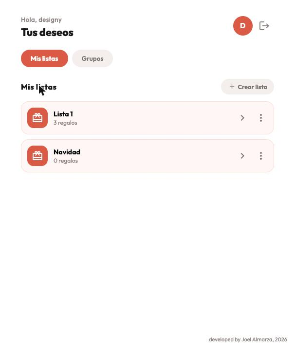
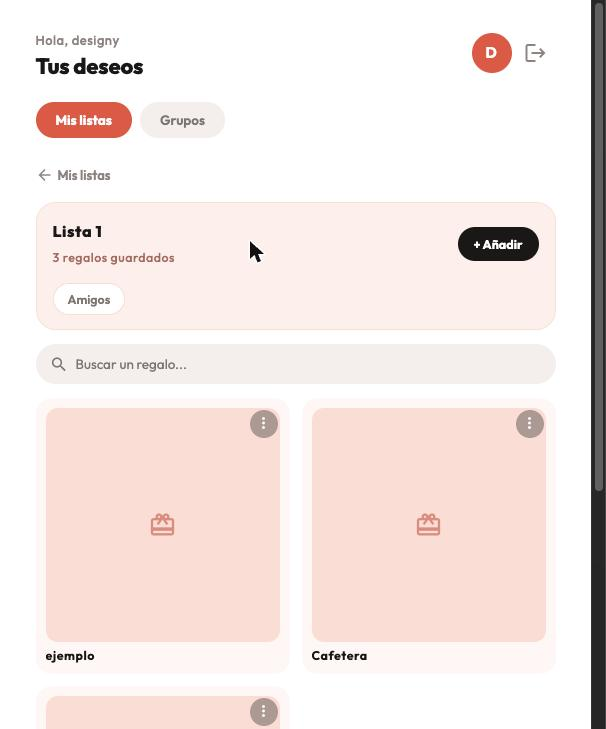
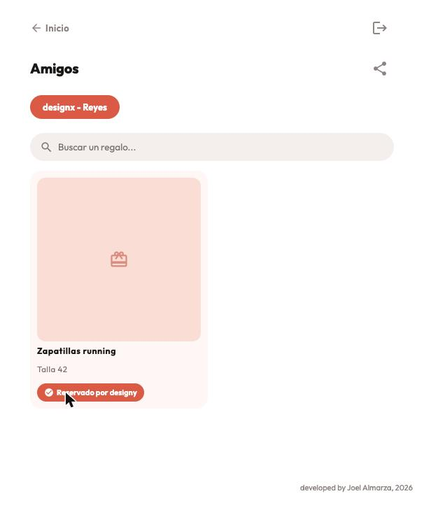

<p align="center">
  
</p>

<h1 align="center">Wishu</h1>
<p align="center"><strong>Listas de deseos que de verdad guardan la sorpresa.</strong></p>

<p align="center">
  Frontend web (Angular) de Wishu. La API vive en <a href="https://github.com/JAlmarza98/wish-list-backend"><code>wish-list-backend</code></a>.
</p>

---

## El problema

Las wishlists compartidas suelen fallar en lo único que importa: la sorpresa. O bien el dueño de la lista puede ver quién ha reservado cada regalo con solo mirar el código fuente de la página, o directamente no hay forma de coordinarse sin acabar preguntando "¿qué querías al final?" por el grupo de WhatsApp. A eso se suma depender de una app de terceros con publicidad, cuentas obligatorias para todo el mundo y tus datos familiares en un servidor que no controlas.

## Cómo lo resuelve Wishu

- **La sorpresa es real, no solo visual.** El propio servidor nunca envía al dueño de una lista quién ha reservado sus regalos — no es una columna oculta con CSS, el dato ni siquiera viaja en la respuesta.
- **Varias listas, cada una con su gente.** Cumpleaños, Navidad, boda... cada lista se comparte de forma explícita con el grupo que tú decidas, no con todo el mundo por defecto.
- **Grupos para coordinarse de verdad.** Invita con un enlace, reserva un regalo para que nadie más lo repita, y listo.
- **Con foto de cada regalo**, para que no haya dudas de cuál es.
- **Tuya, en tu propio servidor.** Sin anuncios, sin analítica de terceros, sin depender de que una empresa decida cerrar el servicio.
- **Instalable como app** (PWA) — se añade a la pantalla de inicio y funciona como una app nativa, en Android, iOS o escritorio.

## Capturas

| Tus listas | Dentro de una lista | Reservando en un grupo |
|---|---|---|
|  |  |  |

## Arquitectura

Wishu es dos proyectos independientes:

| Repo | Qué es | Stack |
|---|---|---|
| `wish-list-frontend` (este) | La aplicación web | Angular 18, Angular Material, TypeScript |
| [`wish-list-backend`](https://github.com/JAlmarza98/wish-list-backend) | La API REST | Node.js, Express, PostgreSQL |

El frontend habla con el backend por HTTP, con la sesión en una cookie `httpOnly` (nunca en `localStorage`). Ambos se despliegan de forma independiente, cada uno con su propio Docker.

## Puesta en marcha

Necesitas [`wish-list-backend`](https://github.com/JAlmarza98/wish-list-backend) corriendo (ver su README).

```bash
npm install
cp src/environments/environment.example.ts src/environments/environment.ts
cp src/environments/environment.example.ts src/environments/environment.development.ts
npm start   # http://localhost:4200
```

`environment.ts` y `environment.development.ts` no están en el repo (van en `.gitignore`, solo `environment.example.ts` sí) porque definen a qué API apunta cada build. El ejemplo exporta:

```ts
export const environment = {
  apiUrl: 'http://localhost:3000', // o la URL de tu API en producción
};
```

### Docker

Usa la imagen publicada en Docker Hub ([`jalmarza98/wishu-frontend`](https://hub.docker.com/r/jalmarza98/wishu-frontend), `amd64`/`arm64`) — no hace falta compilar nada. La URL de la API se fija **al arrancar el contenedor** (variable `API_URL`), así que la misma imagen sirve para cualquier dominio:

```bash
API_URL=https://api.tudominio.com docker compose up -d
```

Sirve la app con nginx en el puerto `8080`. Apunta tu reverse proxy ahí.

¿Prefieres construir tu propia imagen en vez de usar la publicada? Cambia `image: jalmarza98/wishu-frontend:1.1.0` por `build: .` en `docker-compose.yml`.

## Comandos útiles

| Comando | Qué hace |
|---|---|
| `npm start` | Servidor de desarrollo en `http://localhost:4200` con recarga en caliente |
| `npm run build` | Build de producción en `dist/` |
| `npm test` | Tests unitarios (Karma/Jasmine) |
| `ng generate component ruta/nombre` | Genera un componente standalone |

## Stack técnico

Angular 18 (standalone components, sin NgModules) · Angular Material (retemado por completo, sin el azul por defecto) · TypeScript · RxJS · `@angular/service-worker` para la PWA.

## Licencia

[MIT](LICENSE) © Joel Almarza
